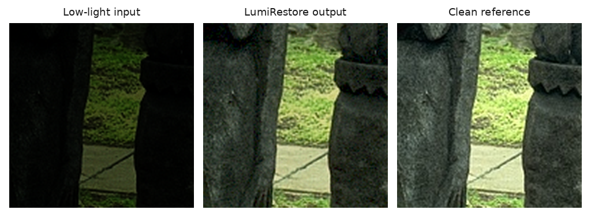

# LumiRestore AI

**Low-Light Image Reconstruction with a Compact Residual U-Net**

*Packaged BSDS300 test-split demo patch. On this example the model lifts mean luminance from 6.0 to 28.7 (out of 100), at 20.34 dB PSNR and 0.873 SSIM against the clean reference.*

LumiRestore AI is a local, CPU-friendly image-processing application that reconstructs a brighter, cleaner RGB image from a low-light input. It combines a classical adaptive-exposure estimate with a learned residual U-Net, so the neural network learns a bounded correction rather than attempting to generate an image from scratch.

The included Streamlit app lets a user upload an image, adjust the model blend, inspect the before/after result, and download the reconstructed PNG. A command-line tool is also included for repeatable batch-style use.

## Problem statement

Low-light photographs often suffer from underexposure, colour shifts, weak contrast, quantisation artefacts, and signal-dependent noise. Simple brightness adjustments can reveal some detail, but they usually do not correct all of those problems together.

**Problem:** Design a reproducible, locally runnable image-reconstruction system that restores synthetic low-light RGB observations while preserving image dimensions and measuring fidelity against clean references on a source-disjoint test split.

## What the project does

1. Accepts a low-light RGB image.
2. Builds a global adaptive-exposure baseline from its luminance.
3. Passes the image through a compact residual U-Net.
4. Adds the predicted residual correction to the baseline and clamps output values to the valid RGB range.
5. Uses feathered tiled inference automatically for large images.
6. Exports a reconstructed PNG and, from the CLI, a JSON execution report.

The application does not claim to recover information that is absent from an image. It is intended as an academic reconstruction project and works best on images whose degradation resembles the synthetic low-light process used during training.

## Core features

- Local CPU inference; no cloud API or GPU is required.
- Pretrained checkpoint included for immediate demo use.
- Source-disjoint train, validation, and test image split.
- Deterministic training seed and saved training history.
- PSNR, SSIM, MAE, and MSE evaluation when a paired clean reference exists.
- Automatic tiled reconstruction for images larger than 384 pixels in either dimension.
- Windows and Linux launch scripts.

## Architecture and method

The model is a three-level residual U-Net with 24 base channels, expanding through 24, 48, 96, and 192 channels. Each residual block uses reflection-padded 3 x 3 convolutions, Group Normalization, and LeakyReLU activations. Decoder features are bilinearly upsampled and fused with encoder skip features.

Before the neural network correction is added, the input is transformed by an adaptive-exposure baseline. The network then predicts a bounded RGB correction using a tanh head. This design makes the reconstruction path interpretable:

- Classical component: global luminance-based exposure correction.
- Learning component: spatial and colour residual reconstruction.
- Output: baseline plus residual, clipped to the 0 to 1 RGB range.

Training uses AdamW, cosine learning-rate annealing, gradient clipping, and the following hybrid objective:

    0.80 x Charbonnier loss + 0.20 x (1 - SSIM)

## Dataset and paired-data generation

The clean-image source is the Berkeley Segmentation Dataset and Benchmark 300 (BSDS300). The project downloads the official image archive on demand and never requires raw source images to be committed to GitHub.

| Split | Images | Construction |
| --- | ---: | --- |
| Train | 160 | Deterministic shuffle of the official 200-image training partition |
| Validation | 40 | Remaining images from the official training partition |
| Test | 100 | Official BSDS300 test partition |

The splits are source-disjoint: an original photograph appears in only one split.

Each clean crop is transformed into a paired low-light observation using the same seeded, camera-inspired synthetic degradation pipeline:

- Gamma darkening sampled from 1.35 to 2.20.
- Exposure sampled from 0.40 to 0.68.
- Smooth horizontal and vertical illumination gradients.
- Mild per-channel colour cast.
- Signal-dependent Gaussian noise.
- 8-bit quantisation.

Training uses 128 x 128 patches and random horizontal flips. The default training setup uses three generated patches per training source image per epoch and one deterministic patch per validation or test image.

See [DATASET_NOTICE.md](DATASET_NOTICE.md) and [data/README.md](data/README.md) for source terms, citation, download behavior, and the repository data policy.

## Measured results

Final checkpoint: 12-epoch CPU run, seed 2024, selected by validation PSNR. Results below are from the fixed, source-disjoint 100-image BSDS300 synthetic test protocol generated by this repository on 2026-09-24; they are not claims about every real camera or night scene.

| Test system | PSNR (dB) | SSIM | MAE | MSE |
| --- | ---: | ---: | ---: | ---: |
| Raw low-light input | 9.9428 | 0.3090 | — | — |
| Adaptive-exposure baseline | 21.1092 | 0.8603 | — | — |
| LumiRestore Residual U-Net | 26.1303 | 0.9346 | 0.050036 | 0.003992 |

The learned model improved over the raw input by 16.1875 dB PSNR and 0.6256 SSIM. The checkpoint has 2,331,147 parameters. Training completed all 12 configured epochs in 438.27 seconds. After warm-up, 12 CPU forward passes on one 128 x 128 test patch measured a 27.782 ms median and 32.749 ms p95 using eight PyTorch CPU threads in the build environment.

PSNR and SSIM are only meaningful here because the test data has a paired clean reference. A user-uploaded photograph without a matched reference can still be reconstructed, but it cannot receive a valid PSNR or SSIM score.

## Quick start

### Windows

Double-click start_windows.bat from the project folder. It finds a supported Python version (3.12, 3.13, or 3.11) through the `py` launcher, creates a virtual environment if needed, installs CPU dependencies, and launches the local application.

### Linux

    chmod +x start_linux.sh
    ./start_linux.sh

### Manual setup

Use Python 3.11, 3.12, or 3.13. PyTorch 2.6 does not publish wheels for Python 3.14 or newer, so installation fails on those versions. The following commands use a virtual environment:

    git clone https://github.com/<praneeth8945>/lumirestore-ai.git
    cd lumirestore-ai
    python -m venv .venv
    source .venv/bin/activate        # Windows: .venv\Scripts\activate
    python -m pip install --upgrade pip
    python -m pip install -r requirements-cpu.txt
    python -m streamlit run app.py

The included checkpoint enables inference immediately after installation. The first full training run additionally downloads the approximately 22 MB official BSDS300 image archive.

## Run the application

After setup, open the local URL printed by Streamlit, usually http://localhost:8501.

The app offers a packaged example by default. To test your own image:

1. Upload a JPG, JPEG, PNG, or WebP image.
2. Set the reconstruction blend. A blend of 1.0 uses the complete model output; a lower value preserves more of the original input.
3. Download the reconstructed PNG.
4. Optionally provide a perfectly aligned clean reference of the same size to calculate PSNR and SSIM.

## Command-line reconstruction

Run the supplied example and request an evaluation report:

    python run_demo.py --input assets/demo_low_light.png --output outputs/reconstructed.png --reference assets/demo_reference.png

For an image without a paired reference:

    python run_demo.py --input path/to/low_light_photo.jpg --output outputs/my_reconstruction.png --blend 0.85

The command writes:

- A reconstructed PNG.
- A JSON report containing input size, tiled-inference information, elapsed time, luminance before and after, and optional paired metrics.

## Reproduce training

Download, extract, and create the deterministic manifest:

    python -m src.prepare_data

Run the full CPU training configuration:

    python -m src.train_model

For a short pipeline smoke test:

    python -m src.train_model --quick

The full command is configured for up to 12 epochs with early stopping after four validation epochs without PSNR improvement. It saves:

- models/lumirestore_residual_unet.pt
- reports/evaluation_metrics.json
- reports/training_history.csv
- assets/demo_low_light.png
- assets/demo_reconstruction.png
- assets/demo_reference.png

Running training replaces the included checkpoint and demonstration assets with the newly measured run.

## Tests

Run the self-contained test suite:

    python -m unittest discover -s tests -v

The tests validate manifest split counts, deterministic degradation, metric identities, adaptive exposure behavior, model shape preservation, checkpoint loading, and tiled inference. They do not need the BSDS300 download.

The same compile check and test suite run automatically on every push and pull request through GitHub Actions (`.github/workflows/validate.yml`).

## Troubleshooting

| Problem | Fix |
| --- | --- |
| `No matching distribution found for torch==2.6.0+cpu` | Your Python is too new or too old. Use Python 3.11, 3.12, or 3.13. |
| The PyTorch CPU index is blocked on your network | Run `pip install -r requirements.txt torch==2.6.0 torchvision==0.21.0` to install the standard PyPI build. It is a larger download but works the same on CPU. |
| `Checkpoint not found` | Make sure `models/lumirestore_residual_unet.pt` was cloned, or retrain with `python -m src.train_model`. |
| Large photos feel slow | Images over 384 px are processed in overlapping tiles. A 1920 x 1080 photo takes 28 tiles and a few seconds on a typical CPU. |
| `python -m src.prepare_data` cannot download | Download `BSDS300-images.tgz` from the official dataset page manually and place it at `data/raw/BSDS300-images.tgz`, then rerun the command. |

## Project structure

    lumirestore-ai/
    ├── app.py                         Streamlit interface
    ├── run_demo.py                    Command-line reconstruction tool
    ├── src/
    │   ├── config.py                  Paths and reproducibility settings
    │   ├── prepare_data.py            Official dataset download and split manifest
    │   ├── dataset.py                 Synthetic paired-data generator
    │   ├── model.py                   Residual U-Net and exposure baseline
    │   ├── metrics.py                 Charbonnier, PSNR, and SSIM functions
    │   ├── train_model.py             Training, evaluation, and checkpoint export
    │   └── predict.py                 Portable and tiled CPU inference
    ├── tests/                         Automated validation tests
    ├── assets/                        Packaged visual example, README comparison image, and metrics
    ├── models/                        Included trained state-dict checkpoint
    ├── reports/                       Training history and measured evaluation report
    ├── data/manifests/                Source-disjoint split manifest
    ├── DATASET_NOTICE.md              Source attribution and terms note
    ├── MODEL_CARD.md                  Model purpose, scope, and limitations
    └── PROJECT_REPORT.md              Project-methodology report

## Technology stack

| Area | Tools |
| --- | --- |
| Language | Python 3.11, 3.12, or 3.13 |
| Deep learning | PyTorch 2.6 CPU, Torchvision 0.21 |
| Image I/O | Pillow |
| Numerical work | NumPy |
| Local user interface | Streamlit |
| Dataset preparation | Python standard library tarfile, urllib, CSV |
| Testing | Python unittest |

## Practical limitations

- The model is trained on synthetic degradations of BSDS300 natural images, not calibrated raw camera data.
- Results on real night scenes, motion blur, severe clipping, extreme sensor noise, or non-RGB inputs may differ from the paired test results.
- PSNR and SSIM should not be reported for an image unless an aligned clean reference is available.
- The packaged demo assets are derived from BSDS300 and retain the source dataset's academic/non-commercial context.
- This is a reconstruction and enhancement project, not a forensic tool or a guarantee of scene truth.

## Citation

If you use the source dataset, cite:

    D. Martin, C. Fowlkes, D. Tal, and J. Malik.
    A Database of Human Segmented Natural Images and its Application to
    Evaluating Segmentation Algorithms and Measuring Ecological Statistics.
    Proceedings of the International Conference on Computer Vision, 2001,
    pages 416-423.

Official dataset page: https://www2.eecs.berkeley.edu/Research/Projects/CS/vision/bsds/

## License

The project source code is released under the [MIT License](LICENSE). The BSDS300 data and derivatives are not relicensed by this repository; see [DATASET_NOTICE.md](DATASET_NOTICE.md).
